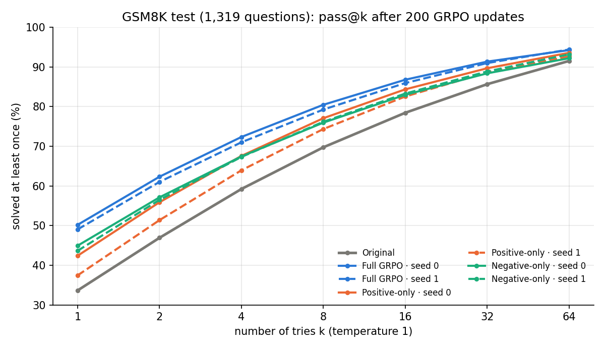
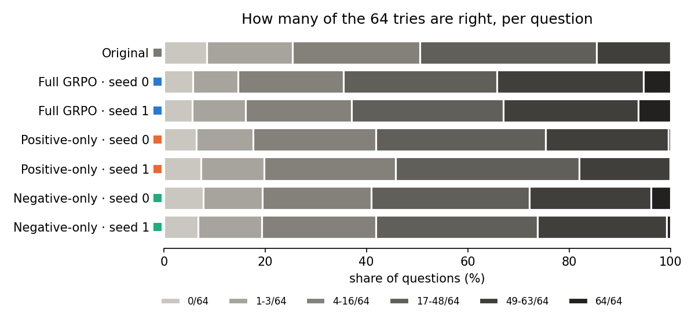
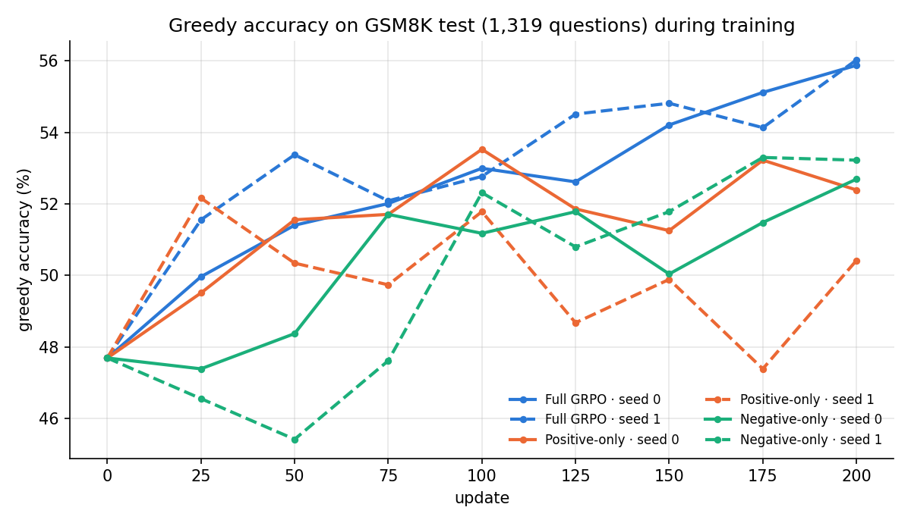

# LLM post-training: GRPO from scratch on GSM8K

A from-scratch implementation of GRPO (Group Relative Policy Optimization) for RL post-training of a small language model, plus one complete study run with it.

## Two questions

1. **Does GRPO need both of its pushes?** GRPO pushes each sampled answer up if it beat its group's average (mostly right answers) and down if it fell below (mostly wrong ones). What happens if you keep only one of the two?
2. **Does RL only sharpen?** Sharpening means the model gets better at picking answers it could already produce. The alternative is that RL teaches it to solve questions it couldn't solve before.

## Answers, for Qwen2.5-0.5B-Instruct on GSM8K

1. **Both pushes are needed.** Normal GRPO beats positive-only and negative-only on single-answer accuracy and at every number of tries from 1 to 64, and both seeds agree. The two halves change the model's behavior in opposite directions:
   - positive-only gives short answers that are almost never cut off;
   - negative-only gives long answers that often hit the length limit.

   But they end up tied on how many questions the model can solve within 16–64 tries. The finding of Zhu et al. (2025), [*The Surprising Effectiveness of Negative Reinforcement in LLM Reasoning*](https://arxiv.org/abs/2506.01347), that positive-only training narrows what a model can solve while negative-only preserves it, did **not** reproduce here.
2. **Mostly sharpening.** Full GRPO's gain over the original model is +16 points at 1 try but only +2.8 at 64 tries. The gains are mostly in reliability on questions the model could already solve sometimes. The small gain left at 64 tries can't be told apart from sharpening answers the original produces only very rarely.



## Results

Each training run: 200 GRPO updates, LoRA, two seeds per arm. Evaluation uses all 1,319 GSM8K test questions; none were used for training.
- **Greedy**: one answer per question, always the most likely token.
- **1 try** and **64 tries** (pass@1, pass@64): 64 answers per question at temperature 1, with the same random seeds per question for every model.

| Model | Greedy | 1 try | 64 tries |
|---|---|---|---|
| Original Qwen2.5-0.5B-Instruct | 47.7% | 33.6% | 91.5% |
| Full GRPO (seed 0 / seed 1) | 55.9 / 56.0 | 50.2 / 49.0 | 94.2 / 94.4 |
| Positive-only (pushes right answers up) | 52.4 / 50.4 | 42.4 / 37.4 | 93.6 / 92.6 |
| Negative-only (pushes wrong answers down) | 52.7 / 53.2 | 44.9 / 43.6 | 92.2 / 93.2 |

Differences in points, mean of two seeds. The 95% intervals come from resampling questions (2,000 draws); they don't cover seed-to-seed variation.

| Comparison | 1 try | 16 tries | 64 tries |
|---|---|---|---|
| Full − original | +16.0 [15.2, 16.7] | +7.9 [6.9, 9.0] | +2.8 [1.5, 4.2] |
| Full − positive-only | +9.7 [9.1, 10.4] | +2.9 [2.2, 3.6] | +1.2 [0.3, 2.1] |
| Full − negative-only | +5.3 [4.8, 5.8] | +3.2 [2.6, 3.9] | +1.6 [0.7, 2.6] |
| Negative-only − positive-only | +4.4 [3.7, 5.0] | −0.3 [−1.1, 0.5] | −0.4 [−1.4, 0.6] |



**What else the runs show:**
- **The halves fail in opposite directions.** Positive-only shortens greedy answers: 307 tokens on average at the start, 133–228 at the end. Negative-only lengthens them to 337–412 tokens and runs into the 512-token limit.
- **Positive-only does not collapse onto fewer answers.** It gives as many distinct final answers per question as the original (18.8 and 22.3 vs 18.6), while full GRPO and negative-only concentrate (about 14).
- **No run shrank the set of questions solved within 64 tries.** Each lost 27–44 questions the original sometimes solved and gained 52–65. The two seeds of an arm lose the same 13–18 questions, where about 1 would be expected by chance.
- **On GSM-Symbolic** (5,000 rewrites of 100 test questions with new names and numbers, greedy), full GRPO beats the original by +5.1 points [2.2, 8.0]. So the gains carry over, but less than on the original wording.



### Caveats
- **Small setting.** One 0.5B model, one benchmark, 200 updates, two seeds per arm. The original already solves 91.5% of questions within 64 tries, so there is little room for the solvable set to grow or shrink. Zhu et al. (2025) used larger models (Qwen2.5-Math-7B, Qwen3-4B, Llama-3.1-8B-Instruct) and harder math (MATH, AIME, AMC), so not reproducing their result here is not evidence against it.
- **Negative-only seed 1 broke.** 45.6% of its sampled answers hit the 512-token limit. Strict scoring still credits a boxed answer written before the cut-off. Counting only answers that stopped on their own, its pass@1 is 30.2%, below the original. The other runs change by at most 0.3 points under that check.
- **Part of the gain is answer formatting.** The scorer only accepts `\boxed{}` or `####` answers. 19.9% of the original's sampled answers end in an unformatted number, against 1.6–4.7% after training (12–13% for negative-only). About 3 of the 16-point pass@1 gain comes from that.
- GSM8K is public and old. Qwen2.5 may have seen it during pretraining. GSM-Symbolic is the partial check.

An interactive version of all results, with training curves, per-question changes and every caveat: **[open the results page](https://seif-222.github.io/LLM-post-training/results.html)** (source: [`docs/results.html`](docs/results.html)).

## What's implemented

Everything in the training loop is written here rather than taken from an RL library (no TRL, verl or OpenRLHF). Hugging Face `transformers`/`peft` provide the model and LoRA; vLLM is used only as a fast sampler.

- **GRPO objective** (`rl/grpo.py`):
  - group-normalized advantages;
  - per-answer, per-token and constant-denominator ("Dr. GRPO") loss weighting;
  - k3 KL penalty to the reference model;
  - PPO-style clipping for multi-update batches;
  - optional truncated importance-sampling correction;
  - the positive-only / negative-only masks used in the study.

  The masks are applied after advantages are computed, with the original denominator, so positive + negative policy gradients sum exactly to the full one. A test checks this.
- **Log-probabilities** (`rl/logprobs.py`): one forward pass through the body, then the LM head on answer positions only, in checkpointed chunks to save memory. Returns entropy too.
- **Sampling** (`rl/rollout.py`, `rl/engine.py`): a Hugging Face `generate` engine, and a vLLM engine that receives the current LoRA adapter every update. The gap between vLLM's and the trainer's log-probs is logged every step, to catch a stale or mismatched adapter.
- **Dynamic sampling.** Spare questions and up to two refill rounds, so each update trains on groups with mixed right and wrong answers.
- **Reward** (`rl/reward.py`): strict or lenient answer parsing, with a random-reward control.
- **Checkpoint and resume** (`rl/checkpointing.py`). Saves adapter, optimizer, scheduler, RNG streams and question order. Files are written to a temp location and then swapped in. On resume, logs are trimmed back to the checkpoint so no update is counted twice. Used for real here: all six runs were interrupted and resumed.
- **Evaluation** (`rl/eval.py`, `rl/evaluation_io.py`):
  - greedy and sampled modes, with the unbiased pass@k estimator;
  - per-question records and seeds derived per question, identical across models;
  - chunked, resumable runs that check every saved chunk.
- **Modal launcher** (`modal_app.py`): pinned image, a volume for outputs, and per-run cost logging.
- **Tests** (`tests/`):
  - CPU tests for the reward parser, the GRPO loss and masks, rollout layout, resume and evaluation I/O;
  - GPU tests, behind `RUN_GPU=1`, for log-prob correctness, resume and the vLLM hand-off.

Study configuration:
- Qwen2.5-0.5B-Instruct with LoRA, rank 16, alpha 32.
- 16 question groups × 8 answers per update, 256 sampled answers per update including spares.
- AdamW, learning rate 1e-4 after a 10-update warmup.
- KL coefficient 0.02.
- Temperature 1.0, at most 512 new tokens.
- Qwen's boxed math prompt.
- One L40S GPU on Modal.

Total compute cost: about $23, made up of $11.89 for training (including tests and repairs) and $10.78 for the final evaluation.

## Layout

```
rl/                 data, reward, rollout, log-probs, GRPO loss, engines, checkpointing, evaluation
train_grpo.py       the training loop (python train_grpo.py --help)
experiments.py      named experiment settings
modal_app.py        Modal image, volume and launchers
scripts/            comparison, campaign/resume tools, final evaluation, figures
tests/              CPU tests; GPU tests with RUN_GPU=1
docs/               figures and the interactive results page
```

## Running it

Requires Python 3.12, PyTorch, transformers 5.x and peft. vLLM and Modal are needed only for the fast engine and the cloud runs.

```bash
python -m pytest -q                                   # CPU tests
python train_grpo.py --run demo --steps 20 --lr 1e-4  # short run on a local GPU (HF engine)
python train_grpo.py --run demo_pos --steps 20 --lr 1e-4 --advantage-mode positive
```

Final evaluation, as run for the results above (needs a Modal account):

```bash
modal run -m scripts.final_eval --k 64 --time-limit-min 50   # 7 models x 1,319 questions x 64 tries + GSM-Symbolic
python scripts/final_eval_links.py --k 64                    # download outputs and write the comparison inputs
python scripts/final_spread.py                               # pass@k buckets, answer spread, gained/lost questions
python scripts/final_figures.py                              # the figures in docs/figures
```

Run outputs (`runs/`) are not in the repository: they are gigabytes of samples and checkpoints.

## Background

- Shao et al., 2024, DeepSeekMath (GRPO): https://arxiv.org/abs/2402.03300
- Liu et al., 2025, Understanding R1-Zero-Like Training (Dr. GRPO): https://arxiv.org/abs/2503.20783
- Zhu et al., 2025, The Surprising Effectiveness of Negative Reinforcement in LLM Reasoning: https://arxiv.org/abs/2506.01347
- Yue et al., 2025, Does Reinforcement Learning Really Incentivize Reasoning Capacity in LLMs Beyond the Base Model?: https://arxiv.org/abs/2504.13837
- Mirzadeh et al., 2024, GSM-Symbolic: https://arxiv.org/abs/2410.05229
